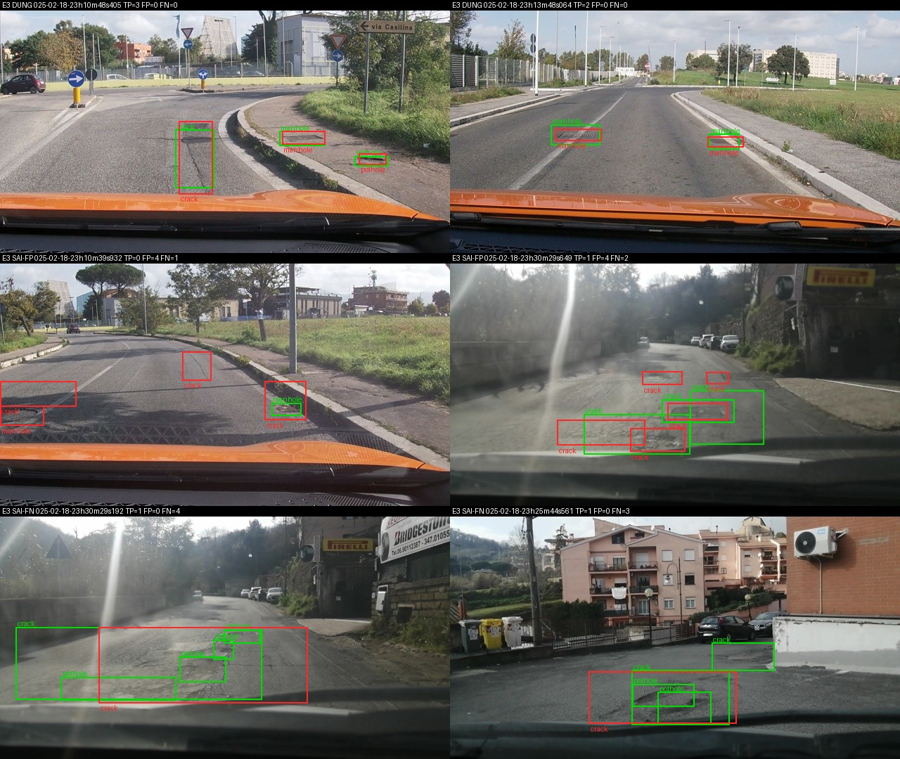

Họ tên: Nguyễn Sơn Giang
`dataset_version`: d10-21e4070301

> Môi trường: Kaggle Notebooks, **1 × Tesla T4 16 GB** (`device_map={"": 0}`), torch 2.11.0+cu128, transformers 5.19.0, peft 0.21.2, trl 1.9.2, bitsandbytes 0.50.2. Mỗi thí nghiệm là một kernel riêng do `kaggle/push.py` sinh ra (đóng gói `lab/` + `scripts/` gốc). Kết quả nhẹ (`*.jsonl`, `run.json`, log) tải về bằng `kaggle/fetch.py` và chấm **trên máy local** bằng `scripts/score.py` gốc. Mã của tôi nằm trong `lab/` (không sửa `scripts/`, `tests/`).

## Bảng tổng hợp (số của bạn, lấy từ `report/evidence/*.json`)

Phút = thời gian vòng huấn luyện (300 bước tối ưu, chưa gồm nạp model và suy luận 311 ảnh ≈ 9–10 phút). VRAM đỉnh = `torch.cuda.max_memory_allocated` trong lúc train (E0: lúc suy luận). Nhật ký từng 10 bước (loss, lr, grad norm, VRAM, phút) và `run.json` của mỗi lần chạy: `report/logs/`.

| Mã | Setup | Tham số huấn luyện | VRAM đỉnh (GB) | Phút | F1 | CI95 | FP/ảnh | F1 pothole | F1 crack | F1 manhole |
|---|---|---|---|---|---|---|---|---|---|---|
| E0 | zero-shot | 0 | 4.24 | 0 (suy luận 15.3) | 0.089 | 0.064–0.115 | 0.95 | 0.107 | 0.035 | 0.186 |
| E1 | LoRA LLM | 33,030,144 | 6.23 | 38.75 | 0.268 | 0.233–0.308 | 1.10 | 0.154 | 0.192 | 0.524 |
| E2 | + projector | 142,135,296 | 7.83 | 39.33 | 0.365 | 0.326–0.410 | 0.99 | 0.224 | 0.262 | 0.678 |
| E3 | + LoRA ViT | 148,426,752 | 8.01 | 51.82 | 0.440 | 0.400–0.480 | 0.90 | 0.316 | 0.341 | 0.727 |
| E4 | data_size = 1.0 (= E3) | 148,426,752 | 8.01 | 51.82 | 0.440 | 0.400–0.480 | 0.90 | 0.316 | 0.341 | 0.727 |
| E4 | data_size = 0.1 (142 ảnh, setup E3) | 148,426,752 | 7.68 | 50.55 | 0.258 | 0.225–0.292 | 1.80 | 0.186 | 0.174 | 0.530 |
| E5 | GRPO từ E3 (60 bước, chỉ LoRA LLM) | 33,030,144 | 6.87 | 38.25 | 0.462 | 0.422–0.507 | 0.69 | 0.326 | 0.365 | 0.735 |

`parse_valid_rate`: E0 0.836 · E1 0.990 · E2 1.000 · E3 1.000 · E4(0.1) 0.997 · E5 1.000. Precision/Recall micro: E0 0.121/0.070 · E1 0.295/0.245 · E2 0.393/0.341 · E3 0.466/0.417 · E4(0.1) 0.232/0.290 · E5 0.527/0.412. Mean IoU các cặp khớp: 0.598 · 0.679 · 0.683 · 0.697 · 0.687 · 0.697.

File evidence: `e0.json`, `e1.json`, `e2.json`, `e3.json`, `e4_data_0.1.json`, `e4_data_1.0.json` (chấm lại chính dự đoán của E3, vì data_size = 1.0 trùng cấu hình E3), `e5.json`.

Ảnh minh hoạ (xanh lá = GT, đỏ = dự đoán; mỗi file 2 ảnh đúng, 2 ảnh sai do FP, 2 ảnh sai do FN):
`report/figures/gt_samples.jpg` (nhãn gốc) · `report/figures/e0_examples.jpg` · `report/figures/e1_examples.jpg` · `report/figures/e3_examples.jpg`.



## 10 câu hỏi (trả lời bằng **số của bạn**, không chép lại tài liệu)

### Câu 1 — Kiến trúc: ViT, projector và LLM của Qwen3-VL-4B có bao nhiêu tham số mỗi khối, và E1/E2/E3 mỗi cái cập nhật khối nào?

Tôi đếm trực tiếp trên model đã nạp (`lab/vlm.py::param_report`, tham số 4-bit được nhân 2 vì 2 giá trị/byte):

| Khối | Module | Tham số |
|---|---|---|
| ViT | `model.visual.patch_embed`, `pos_embed`, 24 `visual.blocks` | 306,242,560 |
| Projector | `visual.merger` (27,271,680) + `visual.deepstack_merger_list.{0,1,2}` (3 × 27,277,824 = 81,833,472) | 109,105,152 |
| LLM | `model.language_model` (36 lớp + `embed_tokens` 151,936 × 2560); `lm_head` buộc chung trọng số với embedding nên đếm 0 | 4,022,468,096 |
| Tổng | | ≈ 4.438 B |

Luồng: ảnh 640×360 → patch 16×16 → 24 khối ViT → merger gộp 2×2 patch thành **220 token** chiều 2560 (DeepStack lấy thêm đặc trưng ở 3 tầng trung gian của ViT, cộng vào các lớp đầu của LLM) → LLM sinh JSON.

- **E1**: LoRA r=16 trên 252 module LLM (36 lớp × `q,k,v,o,gate,up,down`) = 33,030,144 tham số. ViT + projector đóng băng.
- **E2**: E1 + mở **toàn bộ** projector ở fp32: 33,030,144 + 109,105,152 = 142,135,296.
- **E3**: E2 + LoRA trên 96 module ViT (24 khối × `attn.qkv, attn.proj, mlp.linear_fc1, mlp.linear_fc2`) = +6,291,456 → 148,426,752 (348 module LoRA). Tôi dùng regex chỉ khớp `visual.blocks.N.…` để LoRA **không** vô tình gắn vào `merger.linear_fc1/2` (cùng tên `linear_fc*`).

### Câu 2 — E0: `parse_valid_rate` bằng bao nhiêu, và hai lỗi phổ biến nhất của model gốc là gì (kèm một ví dụ output thô)?

`parse_valid_rate` = **0.836** (51/311 output hỏng). Model gốc **không** bọc ```` ```json ```` hay viết văn xuôi (prompt "Output only a JSON list" đủ để nó trả JSON thuần) — lỗi nằm ở chỗ khác:

1. **Lặp vô hạn → JSON bị cắt** (47/51 output hỏng): model "lát gạch" một vết nứt bằng hàng chục box nhỏ dịch đều nhau cho tới khi hết `max_new_tokens=256`, nên thiếu `]`. Ví dụ thô:
   `[{"label": "crack", "bbox_2d": [10, 620, 100, 650]}, {"label": "crack", "bbox_2d": [10, 650, 100, 680]}, {"label": "crack", "bbox_2d": [10, 680, 100, 710]}, … {"label": "crack", "bbox_2d": [10, 770,` (bị cắt)
2. **Bịa box / box sai hình dạng**: 55 box rộng ≥ 900/1000 kiểu dải ngang cả khung hình (`[{"label": "crack", "bbox_2d": [0, 650, 1000, 750]}]`), 34 box trùng lặp y hệt nhau, và sai phân bố lớp — chỉ 28 box `pothole` cho 121 pothole thật, trong khi 215 box `crack` có precision chỉ 0.042. Model gốc hiểu đúng thang 0–1000 (manhole còn khớp được 24 box, mean IoU 0.598) nhưng không biết "ổ gà/vết nứt" trong bộ dữ liệu này trông thế nào và kéo dài tới đâu.

Kết quả: P = 0.121, R = 0.070, F1 = 0.089. Sau SFT (E1) lỗi lặp gần như biến mất (3/311 hỏng, đều là lặp pothole/crack), không còn box rộng ≥ 900, không còn box trùng.

### Câu 3 — Thang 0–1000: nếu chấm output theo pixel (hoặc ngược lại) thì F1 ra sao và vì sao? Bạn đã kiểm chứng điều này thế nào?

Kiểm chứng bằng `scripts/score.py` gốc (file trong `runs/analysis/`, không phải evidence nộp):

| Đầu vào | Chấm với | F1 |
|---|---|---|
| Nhãn GT đi qua `objects_to_answer` (thang 0–1000) | `--coord norm1000` | **1.000** (mean IoU 0.988 do làm tròn số nguyên) |
| Nhãn GT xuất theo pixel (`coord="pixel"`) | `--coord pixel` | **1.000** |
| Nhãn GT xuất theo pixel | `--coord norm1000` (sai thang) | **0.000** (FP/ảnh 1.87) |
| Dự đoán thật của E1 (thang 0–1000) | `--coord pixel` (sai thang) | **0.000** (so với 0.268 khi chấm đúng) |

Vì sao về 0: chấm `pixel` sẽ chia x cho 640 và y cho 360 rồi nhân 1000. Một box 0–1000 bị co theo x hệ số 1000/640 = 1.56 và **giãn** theo y hệ số 1000/360 = 2.78 (ngược lại thì co); box nhỏ (trung vị ≈ 0.4–1.4% khung hình) bị dịch hẳn khỏi vị trí thật nên IoU < 0.5 với mọi GT → mọi dự đoán thành FP, mọi GT thành FN. Vì tỉ lệ x ≠ y nên không có sai lệch "đều" nào cứu được. Thang 0–1000 độc lập độ phân giải: cùng một vị trí tương đối luôn ra cùng một con số dù ảnh 640×360 hay 1280×720, nên model học được một ánh xạ không gian duy nhất — đó cũng là quy ước Qwen3-VL được huấn luyện sẵn (E0 đã ra box đúng thang). Test `lab/tests/test_reward_and_labels.py::test_answer_matches_score_gt` kiểm tra nhãn huấn luyện khớp đúng GT mà trọng tài dùng.

### Câu 4 — Mask loss: vì sao chỉ tính loss trên phần trả lời? Điều gì xảy ra nếu tính trên cả prompt và token ảnh?

Trong smoke test (ảnh train có 9 box), chuỗi đầy đủ dài **563 token**, trong đó **220** token `<|image_pad|>` (image_grid_thw = [1, 22, 40] → 22×40/4 = 220) và phần còn lại là template + prompt; chỉ JSON đáp án + `<|im_end|>\n` được giữ nhãn. Tôi kiểm tra bằng cách giải mã riêng các token có `labels != -100`: ra đúng chuỗi `[{"label":"crack","bbox_2d":[430,467,583,506]},…]<|im_end|>\n`, và `assert` rằng prompt đã mã hoá là tiền tố của chuỗi đầy đủ (nếu không thì vị trí cắt sai).

Lý do: (1) Mục tiêu là p(đáp án | ảnh, prompt); prompt giống hệt nhau ở mọi mẫu và 220 vị trí ảnh đều là cùng một token giữ chỗ `<|image_pad|>` — "dự đoán" chúng không dạy gì về hư hại mặt đường. (2) Loss là trung bình trên các token có nhãn; với ảnh ít box (đáp án ~25–50 token) thì phần trả lời chỉ chiếm ~5–10% số token, nên gradient hữu ích bị pha loãng 10–20 lần, cùng lr 2e-4 và 300 bước model sẽ học chậm hẳn. (3) Tệ hơn, model học cách sinh lại prompt/chuỗi `<|image_pad|>`, có thể làm lệch hành vi lúc sinh. Với mask đúng, loss E1 giảm 1.70 → 0.63 trong 60 bước đầu và về 0.57 ở bước 300 (`report/logs/e1_train_log.jsonl`), và E1 có `parse_valid_rate` 0.990. (Tôi không chạy biến thể không mask để tiết kiệm quota GPU — phần (2)–(3) là lập luận, không phải số đo.)

### Câu 5 — Vì sao không thể huấn luyện đầy đủ projector nếu ViT bị lượng tử hoá 4-bit, và bạn đã xử lý thế nào? Vì sao projector phải ở float32?

Lượng tử hoá 4-bit thay `nn.Linear` bằng `bnb.Linear4bit`: trọng số thành `Params4bit` kiểu **uint8** (2 giá trị/byte, kèm hằng số scale theo khối). Tensor nguyên không thể `requires_grad`, và không có "trọng số thật" để cộng gradient vào — chỉ có thể gắn LoRA bên cạnh. Muốn huấn luyện đầy đủ merger thì nó phải ở dạng dấu phẩy động ngay từ lúc nạp.

Tôi **gặp đúng lỗi này**: với `llm_int8_skip_modules=["visual", "lm_head"]` như đề, transformers 5.19 vẫn để lọt một phần projector thành `Linear4bit`. Smoke test lần đầu báo số tham số huấn luyện của E2 chỉ 87.6M (thay vì 33.0M + 109.1M), lần sau báo `RuntimeError: only Tensors of floating point and complex dtype can require gradients` từ `bitsandbytes/nn/modules.py`. Cách xử lý: liệt kê đủ các tên `["visual", "model.visual", "merger", "deepstack_merger_list", "lm_head"]` và thêm `assert` ngay sau khi nạp model: không module nào chứa `visual` được là `Linear4bit`. Sau đó E2 có đúng 142,135,296 tham số và 24 tensor projector đều fp32.

Vì sao fp32: (1) Huấn luyện fp16 hỗn hợp dùng `GradScaler`; `scaler.unscale_` từ chối gradient fp16 — smoke test lần đầu dừng với `ValueError: Attempting to unscale FP16 gradients`. (2) fp16 chỉ có ~3 chữ số thập phân: cập nhật Adam lr·m/√v ở cỡ 1e-4–1e-5 so với trọng số cỡ 1e-2 sẽ bị làm tròn mất; trạng thái Adam (bình phương gradient) dễ underflow/overflow (max 65504), đặc biệt khi gradient đi qua 4 nhánh merger cộng dồn vào LLM. Với master weight fp32 (và `autocast` fp16 cho phép nhân), loss E2 hữu hạn suốt 300 bước. LoRA của PEFT mặc định cũng ở fp32 vì cùng lý do. Ngoài ra, `save_pretrained` của PEFT không lưu projector, nên tôi lưu riêng `projector.pt` và khi suy luận nạp lại (log: "đã nạp 24 tensor projector") — nếu quên, E2 sẽ quay về projector gốc.

### Câu 6 — Split theo phiên quay: vì sao chia ngẫu nhiên sẽ cho F1 cao giả? Số ảnh và số box từng lớp ở mỗi split là bao nhiêu?

| Split | Ảnh | Session | pothole | crack | manhole |
|---|---|---|---|---|---|
| train | 1,422 | 13 | 1,074 | 1,750 | 691 |
| val | 276 | 2 (`vlc-2025-02-18-18`, `vlc-2025-02-19-16`) | 66 | 470 | 103 |
| test | 311 | 3 (`num-4`, `vlc-2025-02-18-23`, `vlc-2025-02-19-17`) | 121 | 299 | 163 |

Tôi kiểm tra giao các tập session giữa từng cặp split: đều rỗng. Ảnh là các frame liền nhau của video dashcam (ví dụ `vlcsnap-2025-02-18-23h13m48s064` và `…23h13m55s630` cách nhau 7 giây, cùng con đường, cùng hai nắp cống — xem 2 ảnh "DUNG" trong `e1_examples.jpg`). Nếu chia ngẫu nhiên theo ảnh, gần như mọi ảnh test đều có "anh em sinh đôi" trong train lệch vài pixel: model chỉ cần nhớ vị trí box của frame bên cạnh (thậm chí nhớ chiếc xe phía trước hay mảng tường) là đạt IoU ≥ 0.5, nên F1 đo được là khả năng **ghi nhớ**, không phải **tổng quát hoá** sang con đường mới. Khi triển khai trên tuyến đường chưa thấy, F1 thật sẽ thấp hơn nhiều. Chia theo session bảo đảm test là những đoạn đường model chưa từng thấy. Cái giá là phân bố lệch: val chỉ có 66 pothole, test chỉ có 3 session — nên cần F1 từng lớp và CI (câu 8).

### Câu 7 — So sánh E1/E2/E3: mở projector và LoRA trên ViT có đáng không (F1, CI95, VRAM, thời gian)?

Ngoài CI95 riêng của từng setup, tôi tính **bootstrap ghép cặp** (cùng mẫu ảnh cho hai setup, 2000 lần, `lab/paired.py`) cho hiệu F1:

| So sánh | ΔF1 | CI95 của ΔF1 | ΔVRAM | ΔPhút train |
|---|---|---|---|---|
| E1 → E2 (+ projector) | +0.097 | [+0.059, +0.136] | +1.60 GB | +0.6 |
| E2 → E3 (+ LoRA ViT) | +0.075 | [+0.034, +0.117] | +0.18 GB | +12.5 (+32%) |
| E1 → E3 | +0.172 | [+0.129, +0.213] | +1.78 GB | +13.1 |

- **Mở projector rất đáng**: +0.097 F1 với chi phí gần như chỉ là bộ nhớ (109M tham số fp32 + 2 trạng thái Adam ≈ 1.3 GB) và thời gian gần như không đổi (gradient chỉ đi tới merger, không vào ViT). Cải thiện đều ở cả 3 lớp, rõ nhất là manhole (0.524 → 0.678).
- **LoRA ViT cũng đáng trên bài này**: thêm +0.075 F1 (CI ghép cặp không chứa 0), chủ yếu ở hai lớp khó: pothole 0.224 → 0.316, crack 0.262 → 0.341. Đổi lại thời gian train tăng 32% (backward phải đi qua 24 khối ViT với gradient checkpointing), VRAM chỉ +0.18 GB vì LoRA ViT chỉ 6.3M tham số. Trực giác: ViT gốc được huấn luyện trên ảnh tổng quát; vết nứt mảnh và mép ổ gà là đặc trưng kết cấu (texture) mà đặc trưng ViT đóng băng thể hiện chưa tốt, chỉnh projector thôi không đủ.
- Chi phí–hiệu quả: E2 cho nhiều F1 nhất trên mỗi phút train; E3 tốt nhất tuyệt đối và vẫn vừa thoải mái T4 (8.0 GB / 15 GB). Nếu bị giới hạn thời gian GPU thì chọn E2; nếu không, E3.

### Câu 8 — Tập test có 311 ảnh: khoảng tin cậy rộng thế nào, và điều đó giới hạn kết luận so sánh các setup ra sao?

CI95 bootstrap theo ảnh của `score.py` rộng **≈ 0.07–0.08** (≈ ±0.04): E1 0.233–0.308 (0.075), E2 0.326–0.410 (0.084), E3 0.400–0.480 (0.080). Hệ quả:

- Nhìn CI riêng lẻ, E2 (≤ 0.410) và E3 (≥ 0.400) **chồng nhau** 0.010 — nếu chỉ dựa vào đó tôi không dám nói E3 > E2. Bootstrap ghép cặp hẹp hơn vì loại bỏ độ khó chung của từng ảnh: ΔF1 E2→E3 = +0.075, CI [+0.034, +0.117] → khác biệt có ý nghĩa *trên tập test này*. Một khác biệt cỡ 0.02–0.03 thì không phân biệt được.
- Bootstrap theo ảnh **đánh giá thấp** độ bất định thật: 311 ảnh chỉ đến từ **3 session**, và 213 ảnh thuộc cùng một session (`vlc-2025-02-18-23`); các frame liền nhau tương quan mạnh nên số mẫu "độc lập" thực tế nhỏ hơn 311 rất nhiều. F1 của E3 theo session dao động 0.406 (`vlc-2025-02-19-17`, 83 ảnh) – 0.448 (`vlc-2025-02-18-23`, 213 ảnh) – 0.542 (`num-4`, chỉ 15 ảnh). Với 3 session, kết luận "E3 tốt hơn E2" đúng cho cả 3 session (0.350→0.406, 0.364→0.448, 0.478→0.542) nhưng không thể ngoại suy chắc chắn sang mọi loại đường.
- Mỗi kết quả là **một lần chạy, một seed** (42); tôi không đo phương sai giữa các seed huấn luyện, và nó cộng thêm vào độ bất định.
- F1 theo lớp còn bất định hơn: pothole test chỉ có 121 box, nên F1 pothole 0.224 vs 0.316 chỉ là ~10 TP chênh lệch.

### Câu 9 — Phân tích lỗi theo lớp: lớp nào kém nhất và vì sao (kích thước box, số mẫu, ngữ nghĩa)? Kèm ảnh minh hoạ.

Lớp kém nhất là **pothole** (E3: F1 0.316, R 0.273), tiếp theo **crack** (0.341); **manhole** tốt nhất (0.727). Recall của E3 theo kích thước box GT (diện tích so với khung hình):

| Lớp | < 0.3% | 0.3–1% | ≥ 1% |
|---|---|---|---|
| pothole | 8/40 = 0.20 | 15/54 = 0.28 | 10/27 = 0.37 |
| crack | 0/7 = 0.00 | 7/61 = 0.11 | 95/231 = 0.41 |
| manhole | 5/21 = 0.24 | 64/95 = 0.67 | 39/47 = 0.83 |

- **Kích thước**: pothole có diện tích trung vị chỉ 0.38% khung hình (crack 1.44%, manhole 0.43%); 77% pothole test nhỏ hơn 1%. Sau khi gộp 2×2, mỗi token ảnh phủ 32×32 pixel, tức một ổ gà nhỏ chỉ chiếm ~1–2 token — sai 1 token là IoU tụt dưới 0.5. Recall tăng rõ theo kích thước ở cả 3 lớp.
- **Ngữ nghĩa / ranh giới mơ hồ**: lỗi nhầm lớp hay gặp nhất là pothole → crack (17 box có IoU ≥ 0.5 với pothole nhưng gán nhãn crack); mặt đường hư nặng là vùng nứt lẫn ổ gà và chính nhãn GT cũng chồng chéo (ảnh `23h30m29s192`/`…649` trong `e3_examples.jpg`: GT có một box crack lớn bao quanh nhiều box pothole). Crack thì dài, mảnh, ranh giới tuỳ người gán nhãn nên khó đạt IoU ≥ 0.5 dù đã "thấy" đúng vết nứt: model hay vẽ một box gộp cả cụm (ảnh SAI-FN, hàng dưới).
- **Số mẫu**: train có 1,074 pothole nhưng chỉ 691 manhole, vậy mà manhole tốt nhất → số mẫu không phải nguyên nhân chính. Manhole có hình dạng chuẩn (chữ nhật/tròn, viền kim loại, tương phản cao) nên dễ định vị chính xác.
- **Điều kiện ảnh**: ảnh ngược sáng/loá nắng (session `vlc-2025-02-19-17`) có F1 thấp nhất (0.406).

Ảnh minh hoạ: `report/figures/e3_examples.jpg` (ở trên), `e1_examples.jpg`, `e0_examples.jpg`.

### Câu 10 — E4: bạn đổi biến nào, kết quả thế nào, và kết luận có đáng tin không?

Biến: **`data_size`** (chỉ đổi biến này). Gốc là setup tốt nhất **E3** (LoRA LLM + projector fp32 + LoRA ViT, r=16, lr 2e-4, 300 bước × batch hiệu dụng 8, seed 42). Giá trị 0.1 = 142 ảnh lấy ngẫu nhiên (seed 42) từ 1,422 ảnh train; giá trị 1.0 chính là E3. Số bước, lr, lịch lr, batch giữ nguyên — nghĩa là với 10% dữ liệu model thấy mỗi ảnh ≈ 17 lần thay vì ≈ 1.7 lần.

| data_size | Ảnh train | F1 | CI95 | P / R | FP/ảnh | F1 pothole / crack / manhole | Loss train cuối |
|---|---|---|---|---|---|---|---|
| 0.1 | 142 | 0.258 | 0.225–0.292 | 0.232 / 0.290 | 1.80 | 0.186 / 0.174 / 0.530 | 0.026 |
| 1.0 (E3) | 1,422 | 0.440 | 0.400–0.480 | 0.466 / 0.417 | 0.90 | 0.316 / 0.341 / 0.727 | 0.480 |

Kết quả: giảm dữ liệu 10 lần làm F1 giảm 0.182; bootstrap ghép cặp ΔF1 = +0.182, CI95 [+0.145, +0.217]. Hai CI95 riêng lẻ **không chồng nhau** (0.292 < 0.400) và hiệu lớn gấp ~4 lần nửa độ rộng CI, nên kết luận "nhiều dữ liệu hơn tốt hơn rõ rệt" là đáng tin trên tập test này. Cơ chế cũng nhất quán: loss train với 142 ảnh rơi xuống 0.026 (học thuộc), trong khi với 1,422 ảnh vẫn ở 0.48; model 10% sinh nhiều box hơn và sai nhiều hơn (FP/ảnh 1.80 so với 0.90, precision 0.232) — triệu chứng overfit. Đáng chú ý là chỉ 142 ảnh vẫn đưa F1 từ 0.089 (E0) lên 0.258, ngang E1 dùng đủ dữ liệu (0.268).

Giới hạn: (1) chỉ 2 điểm dữ liệu nên không biết đường cong 10% → 100% đã bão hoà chưa; (2) một seed, một tập con 142 ảnh — tập con khác có thể cho kết quả khác; (3) ablation này gộp hai hiệu ứng "ít dữ liệu" và "lặp nhiều epoch hơn" vì tôi giữ số bước cố định — đó là quy ước tôi chọn để chỉ đổi đúng một biến trong config; (4) như câu 8, CI theo ảnh trên 3 session test đánh giá thấp độ bất định thật. Với hiệu 0.18 thì các giới hạn này không đảo ngược được kết luận, nhưng không nên trích dẫn con số chính xác quá mức.

## E5 (bonus) — GRPO với reward IoU

**Hàm reward** (`lab/reward.py`): `0.0` nếu `parse_output` trả `None`; `1.0` nếu cả GT và dự đoán đều rỗng; ngược lại `0.2 + 0.8 · ΣIoU / max(n_gt, n_pred, 1)` với ghép tham lam theo IoU giảm dần, cùng lớp, chỉ nhận IoU ≥ 0.5 (giống `score.py`). Test: `lab/tests/test_reward_and_labels.py` (14 test, `python -m pytest lab/tests -q`, không cần GPU), gồm 5 ca bắt buộc — hoàn hảo = 1.0, JSON hỏng = 0.0, sai lớp = 0.2, thừa box (1 GT khớp + 1 box bịa) = 0.6, cùng rỗng = 1.0 — và các ca chống hack: trả `[]` khi có GT = 0.2, một box khổng lồ `[0,0,1000,1000]` = 0.2 (IoU < 0.5), output bọc markdown vẫn chấm đúng.

**Thiết lập** (`lab/grpo.py`, `trl.GRPOTrainer` của trl 1.9.2): khởi tạo từ adapter LoRA + projector của **E3** (output kernel E3 gắn làm input); chỉ cập nhật LoRA của LLM (33,030,144 tham số), projector và LoRA ViT giữ nguyên trọng số SFT. `num_generations=4`, `max_completion_length=128`, 60 bước, lr 5e-6 hằng số, `beta=0` (không KL, không cần model tham chiếu), nhiệt độ 1.0, 2 ảnh/bước. Hai chỉnh sửa cần thiết trên T4: GRPOTrainer đưa 504 tensor LoRA về bf16 nên tôi ép lại fp32 (lần chạy thử báo `_amp_foreach_non_finite_check_and_unscale_cuda not implemented for 'BFloat16'`); và tôi lọc ảnh train còn ≤ 4 box (1,280/1,422 ảnh) vì 1 box ≈ 22 token — ảnh đông box sẽ bị cắt ở 128 token → JSON hỏng → reward 0 cho cả nhóm, đẩy model về phía "khai ít box". Thời gian train 38.25 phút, VRAM đỉnh 6.87 GB.

**Log huấn luyện** (`report/logs/e5_grpo_log.jsonl`, gồm thống kê reward từng bước và log của TRL; trung bình theo khối 10 bước):

| Bước | reward TB | reward std | JSON hỏng/bị cắt | `[]` khi có GT | box/completion | độ dài TB (token) | nhóm có reward bằng nhau |
|---|---|---|---|---|---|---|---|
| 1–10 | 0.449 | 0.209 | 4.4% | 0% | 1.91 | 57.0 | 10% |
| 11–20 | 0.365 | 0.134 | 1.3% | 0% | 1.72 | 50.2 | 22.5% |
| 21–30 | 0.400 | 0.218 | 3.7% | 0% | 1.65 | 50.5 | 15% |
| 31–40 | 0.372 | 0.155 | 3.7% | 0% | 1.91 | 57.1 | 5% |
| 41–50 | 0.414 | 0.200 | 1.9% | 0% | 1.65 | 48.7 | 25% |
| 51–60 | 0.456 | 0.201 | 0.6% | 0% | 1.64 | 47.6 | 10% |

Reward trung bình dao động theo độ khó của ảnh trong từng lô (mỗi bước chỉ 2 ảnh) và **không có xu hướng tăng rõ** trong 60 bước (10 bước đầu 0.449, 10 bước cuối 0.456) — 60 bước × lr 5e-6 là cập nhật rất nhỏ. Xu hướng nhất quán là completion ngắn dần (57 → 48 token) và tỉ lệ bị cắt/hỏng giảm (4.4% → 0.6%).

**Reward hacking?** Không thấy dạng hack thô: tỉ lệ trả `[]` khi ảnh có GT = 0% suốt quá trình (train/val/test đều không có ảnh rỗng, nên `[]` luôn chỉ được 0.2); chỉ 8 box khổng lồ (> 25% khung hình) trên 960 completion và không tăng dần; trên test không có box khổng lồ nào. Nhưng có một **dịch chuyển nhẹ về phía khai ít box**: trên test, E5 sinh 1.46 box/ảnh so với 1.68 của E3 (GT thật 1.87) — TP gần như giữ nguyên (243 → 240) trong khi FP giảm 279 → 215. Mẫu số `max(n_gt, n_pred)` phạt box bịa, còn một box thiếu chỉ làm mất phần IoU của nó, nên "chỉ khai box chắc chắn" là chính sách an toàn để tăng reward kỳ vọng. Ở mức này nó có lợi cho F1, nhưng nếu huấn luyện lâu hơn có nguy cơ thành bỏ sót có hệ thống (recall giảm); cần theo dõi `pred_boxes_mean` so với `gt_boxes_mean`.

**So với SFT (E3), bằng số kèm CI95:**

| | F1 | CI95 | P | R | FP/ảnh | F1 pothole / crack / manhole |
|---|---|---|---|---|---|---|
| E3 (SFT) | 0.440 | 0.400–0.480 | 0.466 | 0.417 | 0.90 | 0.316 / 0.341 / 0.727 |
| E5 (SFT + GRPO) | 0.462 | 0.422–0.507 | 0.527 | 0.412 | 0.69 | 0.326 / 0.365 / 0.735 |

ΔF1 = +0.023. Hai CI95 riêng lẻ **chồng nhau gần hết**, nên theo tiêu chí đó không kết luận được. Bootstrap ghép cặp cho ΔF1 CI95 [+0.002, +0.044], P(Δ ≤ 0) = 0.012 — dương nhưng sát 0. Kết luận trung thực: GRPO 60 bước cho một cải thiện **nhỏ, chủ yếu qua precision** (0.466 → 0.527, FP/ảnh 0.90 → 0.69), recall không đổi; với một seed, 3 session test và CI ghép cặp gần chạm 0, đây là tín hiệu tích cực nhưng chưa vững — cần nhiều seed/bước hơn để khẳng định.

## Nhìn lại

- **Bẫy thật mà công cụ chấm không bắt được**: với transformers 5.19, `llm_int8_skip_modules=["visual", "lm_head"]` không giữ được projector ở fp16 — một phần merger bị lượng tử hoá 4-bit một cách im lặng. Nếu bỏ qua lỗi bằng cách chỉ mở `requires_grad` cho các tham số còn lại, E2/E3 vẫn chạy nhưng chỉ huấn luyện một phần projector, và `check_submission.py` vẫn PASS. Tôi chỉ phát hiện nhờ đối chiếu số tham số (87.6M thay vì 142.1M) và đã thêm `assert` sau khi nạp model. Bài học: kiểm tra kiểu module/dtype sau khi nạp, không tin vào tên tham số cấu hình.
- **Lỗi môi trường**: torchao 0.10 có sẵn trên Kaggle làm PEFT 0.21.2 lỗi khi gắn LoRA vào `nn.Linear` thường (chỉ xảy ra ở E3 vì ViT không lượng tử hoá) → gỡ torchao. GRPOTrainer tự đưa adapter về bf16, không chạy được với GradScaler fp16 trên T4. Một lần tải output Kaggle trả về trang HTML lỗi 502 thay cho file `.jsonl`; `score.py` báo `JSONDecodeError` nên tôi phát hiện được — nếu file bị cắt cụt mà vẫn là JSON hợp lệ thì `missing_predictions` là tín hiệu duy nhất.
- **Điều chưa hiểu hết / chưa đo**: tôi không chạy biến thể không mask loss nên phần hậu quả ở câu 4 là lập luận; không đo phương sai giữa các seed huấn luyện (mỗi setup một lần chạy) nên không biết bao nhiêu phần của các hiệu 0.02–0.08 là nhiễu huấn luyện; chưa rõ vì sao reward GRPO không tăng rõ trong 60 bước dù F1 test tăng nhẹ — có thể do lô 2 ảnh quá nhiễu (chênh lệch reward giữa các lô lớn hơn mức thay đổi trung bình).
- **Giới hạn dữ liệu**: test chỉ có 3 session (213/311 ảnh từ một session); nhãn crack/pothole chồng chéo (box crack lớn bao các box pothole) nên một phần FP/FN là do quy ước gán nhãn hơn là do model. Thời gian train E1–E3 (38.75 / 39.33 / 51.82 phút) cao hơn ước lượng 20–30 phút của đề; tôi ghi số đo thật trên T4 của Kaggle.
